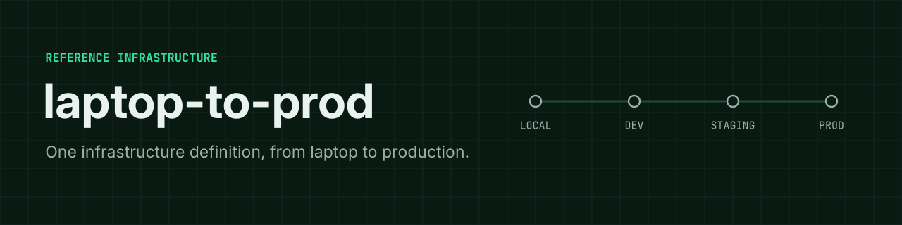

  

# laptop-to-prod

It works on my machine. And on dev, staging and production.

One infrastructure definition for local, dev, staging and production, from virtual machines on a laptop to a Kubernetes cluster.

**Status:** in progress, step 1 of 6 done · Ansible, Kubernetes, ASP.NET Core

Every company I have worked at had four environments: local, dev, staging and production. They never behaved the same. A change worked locally, failed in dev and did something else in staging. By production, nobody was sure what would happen.

The cause was the same each time. Each environment had its own setup, and conditionals held it together: if dev, do this; if staging, do that.

This repo is my attempt at the opposite: one infrastructure definition for all four. Environments differ in values, never in logic. There is no `if env` anywhere in it.

I am building it with Ansible and Kubernetes, around a sample ASP.NET Core API, as the base for my work on AI integration for .NET systems.

Parity is never total. Every difference that remains is listed in [Limits](#limits), with the reason.

## Requirements

- macOS or Linux
- `git`, `make` and `bash`

Each step lists the tools it needs in its own document.

## Steps

Each step builds on the previous one.

| # | Step | What it does | Status |
|---|---|---|---|
| 1 | [Base images](docs/01-base-images.md) | Downloads the Debian installer for amd64 or arm64 and verifies it against Debian's signature and a pinned checksum. `make image` | Done |
| 2 | Virtual machines | Creates the local nodes from one definition. | Not started |
| 3 | Provisioning | Configures the nodes with Ansible. | Not started |
| 4 | Kubernetes | Installs the cluster on the nodes. | Not started |
| 5 | Sample API | Deploys the ASP.NET Core API to the cluster. | Not started |
| 6 | Environments | Runs the same definition on dev, staging and production. | Not started |

## Limits

This repo replicates how environments behave and what they are made of, not how fast they are. Local runs the same components on smaller virtual machines. Everything below differs between environments, on purpose or because it cannot be avoided.

Only step 1 exists today. For everything after it, this section describes the design, not something you can run yet.

### Resources

Node count, CPU, memory, disk and replicas differ. A laptop does not need the capacity of a shared dev cluster, and staging does not need the capacity of production.

These are values, like everything else that differs: set per environment in the Ansible inventory and the Kubernetes values, never in logic.

### Processor architecture

A laptop may be arm64 while the servers are amd64. This one can change behavior, not only speed: a container image built for one architecture does not start on the other, and native dependencies can behave differently.

Base images exist for both architectures. Container images are not built yet.

### Network

Latency, bandwidth and packet loss between nodes on a laptop are nothing like those between servers in a data center. Mostly this is performance, but it can hide behavior: a timeout that never fires locally can fire in production.

Timeouts and retries are explicit values, and they are the same in every environment.

### Certificates

Local and dev cannot get certificates from a public authority for names nobody can reach. They use a private certificate authority; staging and production use a public one. The way certificates are issued and mounted is the same; the issuer is a value.

### DNS

Local names resolve on the laptop; real names resolve on public DNS. Services look each other up the same way inside the cluster; only the external names and who answers for them differ.

### Secrets

Secrets are different in every environment by design. Sharing them would defeat their purpose. The way they are stored, delivered and read is the same; only their values differ.

### Data

Every environment in this repo runs synthetic data; only its size differs.
A real system adds the difference that matters most: production holds
customer data that no other environment holds. Schema and migrations are
the same everywhere.

---

<a href="https://github.com/damian-stankowski">
  <picture>
    <source media="(prefers-color-scheme: dark)" srcset="docs/assets/wordmark-on-dark.svg">
    
  </picture>
</a>
